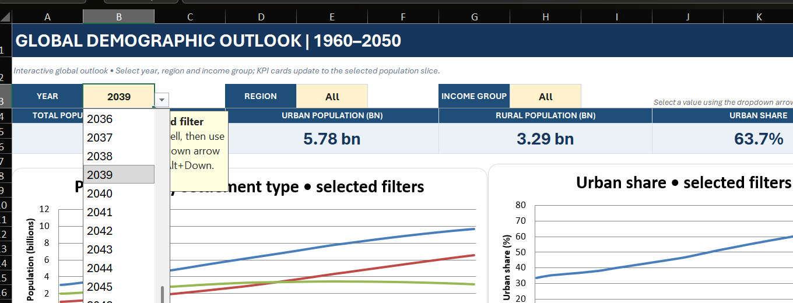

# Global Demographic Insights (1960–2050)
## Interactive Excel Dashboard | Demographic Analytics | LLM-Assisted Workflow

An end-to-end demographic analytics project exploring population change and urbanisation across the economies represented in a supplied population dataset. The main deliverable is an interactive Microsoft Excel workbook supported by original source data, an analytical report, methodology and data-quality documentation, and a documented LLM-assisted analytics workflow.

**Project format:** Excel analytics portfolio project  
**Source coverage:** 19,747 economy-year records, 217 economy codes, 1960–2050  
**Core tools:** Microsoft Excel, Python, openpyxl and LLM-assisted analysis

## Dashboard preview



## Interactive workbook

**[Download the Global Demographic Insights Excel Dashboard](Global_Demographic_Insights_Interactive_Dashboard.xlsx)**

Open the workbook in Microsoft Excel desktop. If Protected View appears, select **Enable Editing**. Select a yellow filter cell and use its dropdown arrow or press `Alt` + `Down Arrow`.

### Dashboard 1 – Global
- Year, region and income-group selectors.
- KPI cards for total, urban and rural population and urban share.
- Population and urbanisation time-series charts.

### Dashboard 2 – Regions
- Region and income-group selectors.
- Regional KPI and comparison visuals.
- Regional and country-level comparisons.

The workbook also includes an analytical report, methodology and data-quality section, work log and supporting data worksheets.

## Project questions
- How has population changed from 1960 to 2050?
- How do urban and rural population trajectories differ?
- How does the urban share evolve over time?
- How do demographic patterns vary by region and income group?
- Which regions show the largest projected increases in urban population?

## Headline findings recorded in the workbook

| Measure | 2023 | 2050 |
|---|---:|---:|
| Total population | 8.00 billion | 9.65 billion |
| Urban population | 4.58 billion | 6.55 billion |
| Rural population | 3.42 billion | 3.09 billion |
| Urban population share | 57.3% | 67.9% |

These are sums across economies represented in the supplied dataset. They should not be described as official World Bank global aggregate series without independent reconciliation to the relevant official aggregate.

## Original source data

The three original input files are included at the repository root and are preserved as supplied:

1. [Population Figures & Projections.csv](Population%20Figures%20%26%20Projections.csv) — primary demographic observations and projections.
2. [Country Groupings.xlsx](Country%20Groupings.xlsx) — economy codes, regions and income-group classifications.
3. [Population Figures & Projections Metadata.xlsx](Population%20Figures%20%26%20Projections%20Metadata.xlsx) — indicator definitions, source notes and aggregation guidance.

The workbook also contains integrated copies in its `Source Data`, `Country Groups` and `Indicator Metadata` worksheets.

## Supporting documentation

- [AGENT_DESIGN.md](AGENT_DESIGN.md) — LLM-assisted workflow design, stages, guardrails and human checkpoints.
- [METHODOLOGY.md](METHODOLOGY.md) — source integration, derived measures and aggregation approach.
- [DATA_DICTIONARY.md](DATA_DICTIONARY.md) — source field definitions.
- [QA_CHECKS.md](QA_CHECKS.md) — data and workbook quality checks.
- [WORK_LOG.md](WORK_LOG.md) — project work record.
- [CHANGELOG.md](CHANGELOG.md) — release history.
- [validate_workbook.py](validate_workbook.py) — structural workbook validation script.
- [requirements.txt](requirements.txt) — Python dependencies for the QA script.
- [LICENSE.md](LICENSE.md) — project documentation/script terms and third-party data caveat.

## Methodology at a glance

1. Inspect source schemas, year coverage, economy codes, indicator definitions and missingness.
2. Match population records to the country-grouping lookup using economy code.
3. Derive total population from female and male population where both components are available.
4. Derive urban share from urban and rural population where both values are available.
5. Aggregate additive population counts across included economies.
6. Compare results by year, region and income group.
7. Present KPIs, trends and comparisons in Excel.
8. Validate row coverage, key uniqueness, code matching, missingness and population reconciliation.

Population counts are additive. Rates and percentages must not be summed; a defensible weighted aggregation is required when a regional rate is needed.

## LLM-assisted analytics workflow

The project documents a bounded LLM-assisted workflow for task interpretation, source inspection, transformation planning, analytical interpretation, dashboard QA and documentation. The LLM is treated as an analytics copilot; human review remains necessary for source decisions, calculation approval, interpretation and testing in Excel.

**This repository does not claim to contain a deployed autonomous agent or executable agent-orchestration service.** The `AGENT_DESIGN.md` document describes the proposed workflow, tool boundaries, guardrails and approval checkpoints.

## Reproducibility and QA

Install the dependencies:

```bash
python -m pip install -r requirements.txt
```

Run the workbook check:

```bash
python validate_workbook.py Global_Demographic_Insights_Interactive_Dashboard.xlsx
```

The script checks workbook structure, expected worksheets, source-data dimensions, year coverage, chart presence and data-validation rules. It does not emulate Excel's calculation engine or prove interactive behaviour in every spreadsheet application. Manual testing in desktop Excel is required.

## Data quality and limitations

- The source contains 19,747 economy-year records, 217 economy codes and years 1960–2050.
- Missing values are retained rather than silently imputed.
- Urban/rural definitions may vary across national statistical systems.
- Future values are projections, not certain outcomes.
- Economy-level totals depend on source coverage and may differ from official aggregates.
- Source metadata should be checked before reusing individual indicators or redistributing extracts.

## Data attribution and licensing

The supplied metadata identifies the World Bank and upstream providers including the United Nations Population Division, national statistical offices and Eurostat. Terms may differ by indicator and provider. Review the applicable terms before redistributing raw files. The project-authored documentation/script terms do not relicense third-party datasets.

Official references:
- [World Bank data licensing](https://datacatalog.worldbank.org/public-licenses)
- [World Bank data terms](https://data.worldbank.org/summary-terms-of-use)
- [UN World Population Prospects](https://population.un.org/wpp/)
- [UN World Urbanization Prospects](https://population.un.org/wup/)

This is an independent analytics project and is not endorsed by the World Bank or United Nations.
